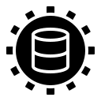

<p align="center">
  
</p>

<h1 align="center">ORMIFY</h1>

<p align="center">
  <a href="https://crates.io/crates/ormify"></a>
  <a href="https://docs.rs/ormify"></a>
  <a href="./LICENSE"></a>
  <a href="https://github.com/Fasterino/ormify">
    
  </a>
</p>

`ormify` is a backend-agnostic, asynchronous ORM core for Rust. It generates entity metadata and typed query builders, then delegates SQL dialect compilation and database I/O to a separate backend crate.

Two implementations are currently available:
[`ormify_postgres`](https://github.com/Fasterino/ormify_postgres).
and
[`ormify_sqlite`](https://github.com/Fasterino/ormify_sqlite).

## Architecture

```text
#[derive(Entity)]
       |
       v
Scheme / Constraint / Entry
       |
       v
Query / Execution
       |
       v
Language::parse_* -> LanguageQuery
       |
       v
Driver::query / execute -> Entry / ExecutionResponse
```

The core deliberately does not depend on a database client or async runtime.

## Installation

```toml
[dependencies]
ormify = { version = "1.0.2", features = ["full"] }
```

### Features

| Feature          | Purpose                                                              |
| ---------------- | -------------------------------------------------------------------- |
| `orm_engine`     | Enables `Ormify`, `Language`, `Driver`, and execution orchestration. |
| `proc_macro`     | Enables the `Entity` and `FieldType` derives and `c!` macro.         |
| `serde_requests` | Enables serializable request/response envelopes.                     |
| `full`           | Enables enables `orm_engine`, `serde_requests`, and `proc_macro`.    |
| `bench`          | Enables benchmark recording on the engine. _Feature for testing._    |

## Defining entities

```rust
use ormify::{Entity, UnixTimeStamp, Uuid, VarChar};

#[derive(Entity)]
#[db(group = "app")]
struct User {
    #[db(pk)]
    id: Uuid,
    #[db(unique)]
    nickname: VarChar<32>,
    #[db(index)]
    age: Option<i32>,
    created_at: UnixTimeStamp,
    #[db(update = UnixTimeStamp::new)]
    modified_at: UnixTimeStamp,
}
```

The derive generates a builder, schema metadata, typed condition and ordering builders, insert/delete helpers, and join support.

Supported field types are `bool`, `i16`, `i32`, `i64`, `f32`, `f64`, `Uuid`, `UnixTimeStamp`, `VarChar<N>`, `Vec<u8>`, and nullable `Option<T>` forms.

Custom field types and enums can derive `FieldType`:

```rust
#[derive(Clone, Default, Debug, ormify::FieldType)]
#[ft(VarChar(32))]
enum Status { Active, Inactive }
```

## Attributes

### Entity - struct attributes

- `#[db(group = "app")]` selects the database schema/group.
- `#[db(rename = "table_name")]` changes a table name.

### Entity - struct fields attributes

- `#[db(rename = "column_name")]` changes a column name.
- `#[db(pk)]` marks a primary-key field.
- `#[db(unique)]` creates a unique constraint.
    - `#[db(unique: constraint_name)]` creates named unique constraint (combines keys if `constraint_name` matches).
- `#[db(index)]` creates an index.
    - `#[db(index: constraint_name)]` creates named index constraint (combines keys if `constraint_name` matches).
- `#[db(fk -> referenced_key in Entity)]` creates a foreign key (combines keys if `Entity` matches).
    - `#[db(fk: constraint_name -> referenced_key in Entity)]` creates named foreign key (combines keys if `constraint_name` matches).
- `#[db(update = expression)]` supplies an automatic update value.

### FieldType - struct/enum attributes

- `#[ft(Vec<u8>)]` marks that struct/enum encodes/decodes itself using `serde`
    - requires `#[derive(Clone, Default, Debug, Serialize, Deserialize)]`

### FieldType - enum attributes

- `#[ft(VarChar(n))]` marks that enum encodes/decodes itself using `VarChar<n>`
    - requires `#[derive(Clone, Default, Debug)]`
- `#[ft(int_type)]` marks that enum encodes/decodes itself using `int_type`, which can be `i16`, `i32` or `i64`
    - requires `#[derive(Clone, Default, Debug)]`

## Queries and writes

```rust
// Without c! macro
let query = User::select()
    .where_(|user| {
        user.nickname().eq("alice") & user.age().between(20, 30)
    })
    .build_query();

// With c! macro
let query = User::select()
    .where_(|user| c!(user.nickname == "alice") & c!(user.age in [20..=30]))
    .build_query();

let insert = User::builder()
    .id(Uuid::new())
    .nickname("alice")
    .build()
    .insert();

let initialization = User::init();
```

A backend-specific `Ormify<L, D>` executes initialization and write commands with `execute`, and reads with `query`.

Foreign-key initialization is dependency-aware when initialization commands are submitted together. Cyclic foreign-key graphs require a backend migration strategy that creates constraints after tables.

## Implementing a backend

A backend implements:

- `Language`: converts `SchemedQuery` and `SchemedExecution` into `LanguageQuery` values;
- `Driver`: connects, executes a query, and executes a transaction of compiled commands;
- `Supported<L>`: associates a driver with its language.

`LanguageQuery::args` must remain in the same order as the dialect's placeholders. Drivers should bind values as parameters rather than interpolating them into SQL.

## Joins

The current engine loads joins recursively with additional queries. A join is declared on the parent select and its callback returns the foreign-key mapping plus a child `SelectBuilder`. Multiple joins are loaded in declaration order. Recursive joins can be nested inside a child builder.

This strategy is convenient for typed nested responses but may issue multiple queries per parent row. The result shape mirrors the join declarations, not a flattened SQL row set.

## Errors and transactions

Fallible operations return `ormify::Result<T>`. Initialization and write commands are sent to the driver as one transaction. If compilation or execution fails, the engine restores its in-memory scheme registry and the driver transaction must roll back.

## Transforming query responses

`Ormify::query` returns a transport-level `QueryResponse`. The [`Transform`] trait converts it into a type chosen by the caller. This keeps database access separate from application-facing model shape.

```rust
let response = db.query(User::select()).await?;

// A collection is the natural choice when the query may return many rows.
let users: Vec<User> = Transform::transform(response)?;
```

For a query expected to return at most one row, use `Option<T>`: an empty response becomes `None`. Transforming directly to `T` requires at least one row.

```rust
let user_opt: Option<User> = Transform::transform(response)?;

// Throws Error::EmptyResponse if response is empty
let user: User = Transform::transform(response)?;
```

### Use `Observer<T>` when updating or deleting loaded entities

`Observer<T>` wraps an entity together with a snapshot of its original database values. It dereferences to `T`, so fields can be read and edited like ordinary entity fields. Calling `update()` compares the current values against the snapshot and creates an update execution containing only changed fields; `delete()` builds a delete condition from the original primary-key values.

```rust
let response = db.query(User::select()).await?;
let mut users: Vec<Observer<User>> = Transform::transform(response)?;

if let Some(user) = users.first_mut() {
    user.nickname = "Updated nickname".into();
    db.execute(vec![user.update()]).await?;
}
```

Use `Observer<T>` when later operations should target the row that was actually loaded. Use plain `T` when you only need values or do not need snapshot-based update/delete behavior.

### Match `Joined` to the join structure

`Joined<Parent, Children>` contains one parent and a typed tuple of child collections. `Children` is an `Entities` tuple with one **child entity type** per `.join(...)` call, in declaration order. The `Entities` implementation turns each tuple member into a `Vec` automatically, so the type arguments are not themselves wrapped in `Vec`.

One join:

```rust
let query = User::select()
    .join::<Post>(|fk, posts| (fk.author_id, posts))
    .build_query();
let response = db.query(query).await?;
let users: Vec<Joined<User, Post>> = Transform::transform(response)?;
```

Multiple joins at the same level use one tuple slot per join, in declaration order. For example, two joins produce a pair of child collections:

```rust
let query = User::select()
    .join::<Post>(|fk, posts| (fk.author_id, posts))
    .build_query();
let response = db.query(query).await?;
let users: Vec<Joined<User, (Post, Comment)>> = Transform::transform(response)?;
```

Nested joins recursively nest the `Joined` child type. For users with posts and comments under each post:

```rust
type PostWithComments = Joined<Post, Comment>;
type UserWithPosts = Joined<User, PostWithComments>;


let query = User::select()
    .join::<Post>(|fk, posts| (
        fk.author_id,
        posts.join::<Comment>(|fk, comments| (fk.post_id, comments))
    ))
    .build_query();
let response = db.query(query).await?;
let users: Vec<UserWithPosts> = Transform::transform(response)?;
```

Use `Observer<T>` instead of `T` at any level that may be updated or deleted using its loaded-row snapshot. For example, observe all three entity levels with:

```rust
type ObservedPostWithComments =
    Joined<Observer<Post>, Observer<Comment>>;
type ObservedUserTree =
    Joined<Observer<User>, ObservedPostWithComments>;
```

You can mix observed and plain entities; for example, observe the parent but keep children plain if only the parent will be modified. The example crate demonstrates this using aliases for its user/post/comment response tree.

Joins currently execute recursively on the client side and may issue additional queries per parent row. The response nesting follows the join declarations, not the SQL row-flattening convention.

## Migrations

In version 1.1.0, there will be migration tools for database, including tools compatible with build scripts. More information soon.

## License

[MIT.](./LICENSE)
